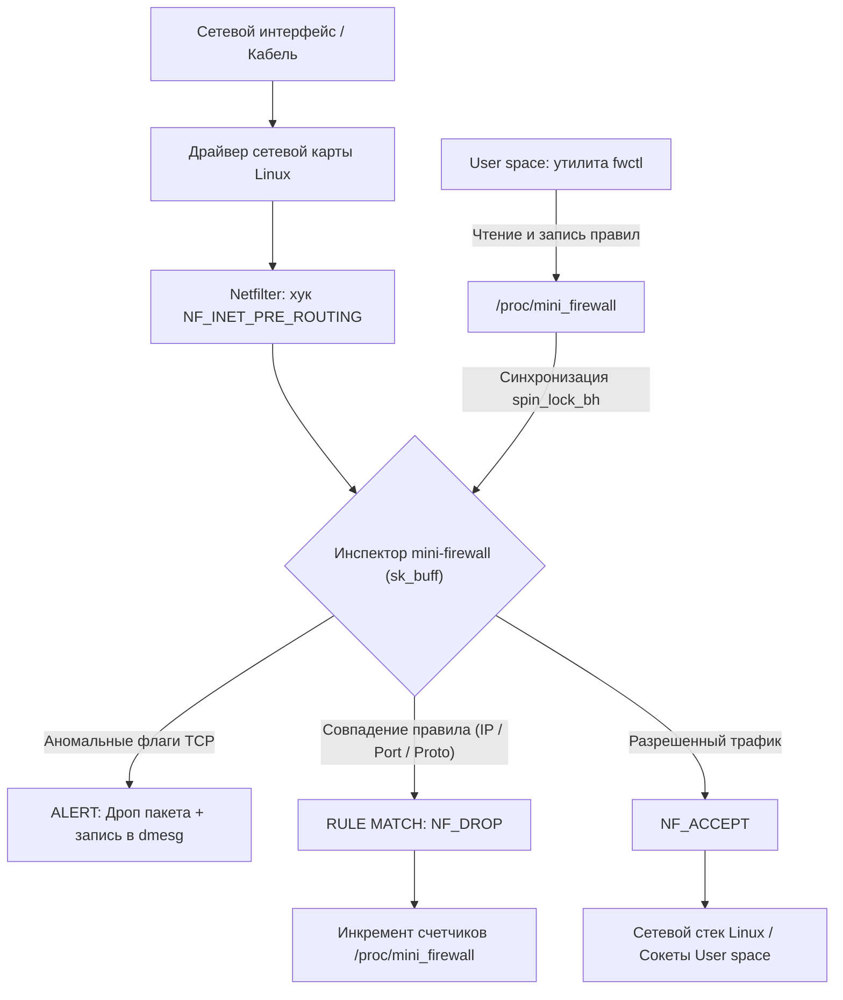

# 🛡️ mini-firewall — Сетевой пакетный фильтр и монитор безопасности на базе модуля ядра Linux (Netfilter LKM)

[](https://en.wikipedia.org/wiki/C99)
[](https://kernel.org)
[](https://netfilter.org)
[](tests/test_firewall.sh)
[](LICENSE)

> **Высокопроизводительный загружаемый модуль ядра Linux (LKM) для фильтрации сетевого трафика и защиты от атак.**  
> Перехватывает входящие сетевые пакеты на уровне ядра (`NF_INET_PRE_ROUTING`), анализирует заголовки IPv4/TCP/UDP/ICMP внутри структуры `sk_buff`, обнаруживает скрытые сканирования портов, ведет счетчики в реальном времени и управляется собственной консольной утилитой (`fwctl`).

---

## 🧭 Архитектура и прохождение сетевого пакета



### Ключевые концепции ядра Linux в проекте:
* **Хуки Netfilter:** Интеграция на этапе `NF_INET_PRE_ROUTING` с наивысшим приоритетом `NF_IP_PRI_FIRST`. Вредоносный трафик отбрасывается до того, как ядро начнет тратить процессорное время на поиск маршрута и аллокацию структур сокетов.
* **Разбор сокетного буфера (`sk_buff`):** Прямое извлечение сетевых заголовков (`struct iphdr`, `struct tcphdr`, `struct udphdr`, `struct icmphdr`) с корректной конвертацией порядка байт (`ntohs`, `in4_pton`).
* **Контекст прерываний (Softirq / Bottom Half):** Хук Netfilter выполняется в контексте программного прерывания, где запрещено усыплять поток (вызывать sleep/schedule). Вся синхронизация таблицы правил и телеметрии реализована через спинлоки нижних половин: `spin_lock_bh` / `spin_unlock_bh`.
* **Управление на лету через Procfs:** Виртуальный файл `/proc/mini_firewall` реализован с использованием современного интерфейса `struct proc_ops` (совместимо с ядрами Linux 5.6+ и 6.x), позволяя менять правила на горячую без перезагрузки модуля.
* **Защита от скрытого сканирования:** Анализ аномальных комбинаций TCP-флагов для пресечения разведки портов злоумышленниками (NULL-scan, Xmas-scan, SYN-FIN scan).

---

## ✨ Возможности

- [x] **Фильтрация по IP:** Мгновенный сброс пакетов от заблокированных IPv4-адресов источника или назначения.
- [x] **Фильтрация по портам:** Блокировка входящих TCP/UDP портов без накладных расходов User space.
- [x] **Стелс-режим (ICMP Stealth):** Игнорирование эхо-запросов ping, делающее хост «невидимым» для сетевого сканирования.
- [x] **Детектирование сканирования портов:** Автоматический отлов и сброс пакетов с некорректными флагами TCP (Xmas, NULL, SYN-FIN) с логированием в кольцевой буфер ядра (`dmesg`).
- [x] **Телеметрия в реальном времени:** Подсчет обработанных, пропущенных, заблокированных пакетов и байт с детализацией причин блокировки.
- [x] **CLI-утилита управления (`fwctl`):** Консольная программа на чистом C с поддержкой ANSI-цветов, управлением правилами и режимом живого мониторинга.
- [x] **Автоматизированный тестовый стенд:** Скрипт валидации, симулирующий сетевой трафик, проверяющий реальное отбрасывание пакетов ядром и точность счетчиков.

---

## 🚀 Быстрый запуск

### Требования
* Операционная система: Linux (рекомендуется Ubuntu 22.04 / 24.04, ядро 5.x или 6.x)
* Установленные заголовки ядра:  
  `sudo apt-get install -y build-essential linux-headers-$(uname -r)`

### 1. Сборка модуля ядра и CLI-утилиты
```bash
make
```

### 2. Загрузка модуля в ядро Linux
```bash
sudo make load
```
Проверка через `dmesg`:
```text
mini_firewall: initializing Netfilter LKM Packet Filter v1.0.0...
mini_firewall: Netfilter hook registered at NF_INET_PRE_ROUTING successfully.
mini_firewall: Control interface active at /proc/mini_firewall
```

### 3. Запуск автоматических тестов
```bash
sudo make test
```
Вывод тестов:
```text
======================================================
   Running mini-firewall Kernel & CLI Test Suite
======================================================
[INFO] Test 1: Baseline ICMP (ping) connectivity...
[PASS] Baseline traffic allowed without rules.
[INFO] Test 2: Blocking ICMP protocol...
[PASS] ICMP packet successfully dropped by kernel hook!
[PASS] Kernel stats verified: Protocol drop counter incremented (1).
[INFO] Test 3: Blocking TCP Destination Port 54321...
[PASS] Rule correctly registered in kernel rule table.
[PASS] TCP connection to port 54321 dropped by Netfilter!
[INFO] Test 4: TCP Anomaly & Port Scan Detector Toggle...
[PASS] Scan detection toggle enabled successfully.
[INFO] Test 5: Resetting rules and checking restoration...
[PASS] Traffic fully restored after clearing rules.

======================================================
   ALL TESTS PASSED! (5/5)
   mini-firewall is operational, verified, and stable.
======================================================
```

---

## 💻 Использование консольной утилиты (`fwctl`)

Утилита управления предоставляет удобный интерфейс в стиле современных сетевых инструментов:

```bash
# Просмотр текущего статуса и счетчиков трафика
./cli/fwctl status

# Заблокировать IP-адрес
sudo ./cli/fwctl block ip 192.168.1.150

# Заблокировать входящий TCP-порт 8080
sudo ./cli/fwctl block port 8080 tcp

# Включить стелс-режим (блокировать входящие ping-запросы ICMP)
sudo ./cli/fwctl block proto icmp

# Включить детектор скрытого сканирования портов
sudo ./cli/fwctl scan-detect on

# Запустить режим живого мониторинга трафика в реальном времени
./cli/fwctl monitor

# Очистить все правила файрвола
sudo ./cli/fwctl clear
```

### Пример вывода статуса в терминале:
```text
┌────────────────────────────────────────────────────────┐
│   mini-firewall CLI (v1.0.0) - Linux Kernel Filter     │
│   Author: Albert Adamyan                               │
└────────────────────────────────────────────────────────┘
=== mini-firewall (Stateful Netfilter LKM Firewall) ===
Version: 1.0.0
Hook stage: NF_INET_PRE_ROUTING
Scan detection: ENABLED

--- Statistics ---
Total Processed: 4820
Accepted:        4791
Dropped:         29
Dropped Bytes:   2465 bytes
  - Drops by IP:       14
  - Drops by Port:     11
  - Drops by Protocol: 4
  - Drops by Scan:     0

--- Active Rules (3/64) ---
  [1] BLOCK SRC IP:   192.168.1.150 (Hits: 14)
  [2] BLOCK TCP PORT: 8080 (Hits: 11)
  [3] BLOCK PROTO:    ICMP (ping) (1) (Hits: 4)
==================================================
```

---

## 📂 Структура проекта

```text
mini-firewall/
├── Makefile               # Главный Makefile сборки, загрузки, тестов и выгрузки
├── README.md              # Документация проекта и архитектурная схема
├── kernel/
│   ├── Kbuild             # Конфигурация сборки модуля ядра Linux (Kbuild)
│   ├── Makefile           # Makefile сборки модуля ядра
│   ├── mini_firewall.h    # Структуры данных, правила, статистика и константы
│   └── mini_firewall.c    # Исходный код модуля ядра (Netfilter hook, procfs ops)
├── cli/
│   ├── Makefile           # Makefile сборки CLI-утилиты
│   └── fwctl.c            # Исходный код утилиты управления на чистом C
├── tests/
│   └── test_firewall.sh   # Автоматический проверочный стенд (5 тестов)
└── docs/
    └── INTERVIEW_QA.md    # Шпаргалка с техническими вопросами и ответами для собеседования
```

---

## 👤 Автор
* **Альберт Адамян**
* GitHub: [@CreatorShyMoon](https://github.com/CreatorShyMoon)
* Telegram: [@moon_dsdsdsss](https://t.me/moon_dsdsdsss)
* Email: [albertadaman70@gmail.com](mailto:albertadaman70@gmail.com)
